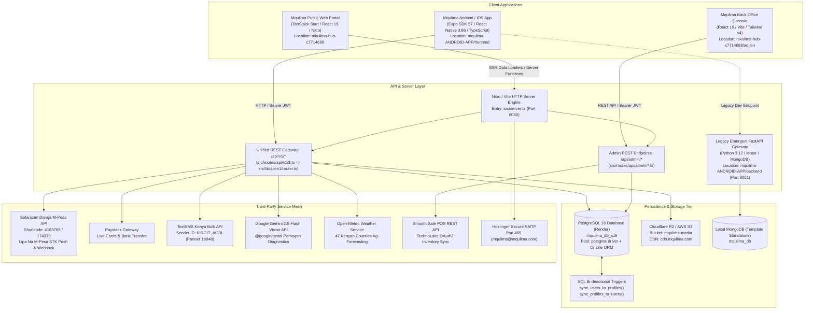

# 01 — MASTER SYSTEM OVERVIEW
## Mqulima (Kirgit Agri) Agricultural Commerce & Technology Ecosystem

---

### Executive Summary

**Mqulima** (also branded as **Kirgit Agri**) is an end-to-end, multi-tenant agricultural commerce and technology platform designed for East African farmers, agro-input dealers, cooperative aggregators, and agribusiness service providers.

The ecosystem encompasses three distinct software domains:
1. **Mqulima Android Application** (`mqulima-ANDROID-APP/frontend`): A cross-platform mobile application built on **React Native (v0.86.3) and Expo SDK 57** with **Expo Router v57**, typed routes, and strict TypeScript. It features a complete farmer mobile workflow including product discovery, shopping cart, checkout, Safaricom Daraja M-Pesa STK push & Paystack card payments, community discussion forums, Google Gemini AI crop diagnostics, offline-resilient local caching, and an operations management console.
2. **Mqulima Public Web Platform & API Server** (`mkulima-hub-c7714688`): A server-side rendered (SSR) web application powered by **TanStack Start (v1.167), TanStack Router (v1.168), React 19, and Vite 7 / Nitro server**. It hosts the core consumer web portal, marketing funnels, interactive agronomy advisory tools, and the unified REST API gateway (`/api/v1/*`) that services both web and mobile clients.
3. **Mqulima Back-Office Admin Console** (`mkulima-hub-c7714688/admin`): A dedicated single-page application (SPA) built with **React 19, Vite, and Tailwind CSS v4** mounted at port `8081` (and proxied in production). It provides 17 operational management modules covering customer identity, catalog stock control, order dispatch, payment ledger reconciliation, forum moderation, agritech news publication, and smooth-sale point-of-sale (POS) synchronization.

---

### Ecosystem Topology & Physical Architecture

---

### Core Business Objectives & Capabilities

The Mqulima ecosystem addresses critical structural challenges in East African agricultural supply chains:

1. **Agro-Input Marketplace & Discovery**:
   - Access to certified seeds, fertilizers, crop protection chemicals, veterinary medicines, animal feeds, and farm equipment.
   - Elimination of counterfeit agro-inputs through direct distributor and agrovet partner integration.
   - Comprehensive multi-token search supporting local agricultural colloquialisms and Kenyan crop types (e.g., *drench*, *jembe*, *npk*, *foliar*, *can*, *dap*, *f1 hybrid*).

2. **Omnichannel Order & Payment Processing**:
   - Seamless ordering via native mobile application and web portal.
   - Instant mobile money payment execution via **Safaricom Daraja Lipa Na M-Pesa Online STK Push**, prompting the farmer's handset with an automated PIN dialog.
   - Secondary card and digital bank payment settlement via **Paystack**.
   - Automated real-time payment reconciliation matching asynchronous Safaricom webhook callbacks (`/api/mpesa/callback`) with pending database transactions.

3. **Multi-Store Inventory & Point-of-Sale (POS) Parity**:
   - Integration with physical agrovet store depots (Eldoret, Kitale, Nakuru, Nairobi) via **Smooth Sale POS API**.
   - Automated 30-minute background cron synchronization (`src/jobs/productSync.job.ts`) ensuring online stock counts mirror physical warehouse stock.

4. **Agronomic Intelligence & AI Crop Diagnostics**:
   - Real-time multimodal vision diagnostic engine powered by **Google Gemini 2.5 Flash**.
   - Farmers capture crop leaves or stem lesions via mobile camera; the system extracts visual pathogen markers and outputs structured disease identification, confidence ratings, organic remedies, and labeled chemical treatments.
   - Contextual agronomic streaming advisor tuned for Kenyan agro-ecological zones, rainfall calendars, and pest pressures (e.g., Fall Armyworm, Tuta Absoluta, Early/Late Blight).

5. **Weather & Precision Agro-Meteorology**:
   - Hyperlocal 7-day agricultural forecasting covering all **47 Kenyan counties** via **Open-Meteo REST API**.
   - Calculates spray window suitability indices, FAO-56 Penman-Monteith evapotranspiration rates ($ET_0$), and soil moisture levels to guide field applications.

6. **Farmer Social Community & Agronomy Extension**:
   - Peer-to-peer farmer knowledge sharing forum with topic tags, location indicators, image attachments, threaded discussions, likes, and bookmarks.
   - Agricultural masterclasses (Mqulima Academy) offering structured agronomy modules and digital waitlist enrollments.
   - Direct field service dispatch for soil testing, tractor mechanization, and agronomist consultations.

---

### Project Repository Roles & Responsibilities

| Attribute | Project A (`mqulima-ANDROID-APP`) | Project B (`mkulima-hub-c7714688`) |
| :--- | :--- | :--- |
| **Primary Role** | Standalone Native Farmer Client & Mobile Operations Tool | Authoritative Core Platform, Web Portal, Admin Console & Database Backend |
| **Technology Stack** | React Native 0.86, Expo SDK 57, Expo Router 57, TypeScript | TanStack Start 1.167, React 19, Nitro / Vite 7, Tailwind v4, Drizzle ORM |
| **Ancillary Components**| Local Python FastAPI + MongoDB prototype (`backend/`) | Standalone React 19 Vite Admin SPA (`admin/`), 47+ SQL migrations (`db/`) |
| **Runtime Target** | Android APK / AAB, iOS IPA, Expo Go QR, Web Preview (Metro:3000) | Node.js SSR Server (Port 8080), Admin Console (Port 8081), Render / Vercel |
| **Primary Persistence** | Hardware SecureStore (tokens) + AsyncStorage (state caching) | PostgreSQL 16 on Render (`mqulima_db_icl9`) |
| **External Auth** | Bearer JWT Header (`Authorization: Bearer <token>`) | HTTP-Only Cookies (`mq_session`) + Admin Bearer Tokens |
| **Shared API Gateway** | Consumes `/api/v1/*` via `src/services/api.ts` | Hosts `/api/v1/*` via `src/routes/api/v1/$.ts` + `src/lib/api-v1/*` |

---

### Fundamental Architectural Discovery: The Integration Bridge

A central objective of this audit was to establish the true relationship between the Android project and the website repository.

The technical discovery reveals:
1. **The Emergent Template Origin**: `mqulima-ANDROID-APP` was initially generated from an Emergent mobile template consisting of a React Native Expo frontend and a localized Python FastAPI + MongoDB backend on port `8001`.
2. **The Modern Unified Architecture**: Rather than maintaining a separate MongoDB database for mobile, a production-grade integration layer was constructed inside `mkulima-hub-c7714688`. The website backend includes a comprehensive **`/api/v1/` REST router** (`src/routes/api/v1/$.ts` and `src/lib/api-v1/*.ts`) that implements the complete API contract expected by the mobile client (`api.ts`).
3. **The Current State of Connection**:
   - In production configuration (`EXPO_PUBLIC_BACKEND_URL=https://www.mqulima.com`), the Android application interfaces directly with the central PostgreSQL 16 database, sharing orders, accounts, stock, and forum posts with the web and admin console.
   - In local development configuration, `mqulima-ANDROID-APP/frontend/.env` still specifies `EXPO_PUBLIC_BACKEND_URL=http://localhost:8001`, targeting the localized FastAPI/MongoDB container unless updated.
   - In `mkulima-hub-c7714688`, the `/api/v1` routes exist and connect to PostgreSQL, but currently contain **13 TypeScript compiler errors** that prevent clean compilation and deployment if strict checks are enforced.

