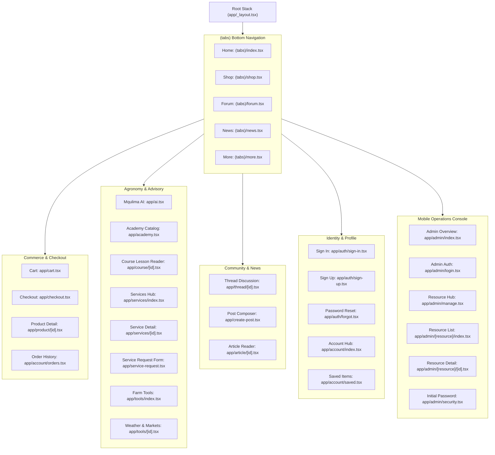

# 02 — ANDROID APPLICATION ARCHITECTURE AUDIT
## Mqulima Mobile Client (`mqulima-ANDROID-APP/frontend`)

---

### 1. Technology Stack & Build Configuration

| Component | Technology | Version | Location |
| :--- | :--- | :--- | :--- |
| **Framework** | Expo SDK | `57.0.29` | `frontend/package.json` |
| **Core Runtime** | React Native | `0.86.3` | `frontend/package.json` |
| **UI Library** | React | `19.2.3` | `frontend/package.json` |
| **Routing** | Expo Router (Typed Routes) | `57.0.27` | `frontend/app/` |
| **State Management**| React Context + AsyncStorage + SecureStore | `2.2.0` / `57.0.4` | `frontend/src/store/AppStore.tsx` |
| **Async Data Cache**| TanStack Query (React Query) | `5.102.8` | `frontend/src/query-client.ts` |
| **Animation Engine**| React Native Reanimated | `4.5.1` | `frontend/package.json` |
| **Keyboard Management**| React Native Keyboard Controller | `1.21.9` | `frontend/package.json` |
| **Vector Icons** | Lucide React Native + FontAwesome 6 | `14.0.0` | `frontend/package.json` |
| **Language** | TypeScript (Strict Mode) | `6.0.3` | `frontend/tsconfig.json` |
| **Bundle ID** | `com.emergent.agriecosystem.dg1zxg` | `1.0.0` | `frontend/app.json` |

---

### 2. Application Entry Points & Lifecycle Architecture

#### Application Boot Sequence
1. **Host Boot**: Expo initializes via `expo-router/entry` (configured in `frontend/package.json:3`).
2. **Root Layout Mounting (`frontend/app/_layout.tsx`)**:
   - `ErrorBoundary` wraps the entire component tree to prevent unhandled render crashes.
   - `QueryClientProvider` initializes the global TanStack Query cache (`src/query-client.ts`).
   - `KeyboardProvider` configures native keyboard interaction buffers.
   - `AppProvider` (`src/store/AppStore.tsx`) mounts:
     - Asynchronously loads stored state (`cart`, `saved` IDs) from `AsyncStorage` key `mqulima_state_v2`.
     - Checks `Expo SecureStore` for `auth_token`.
     - If a token exists, renders cached user details from `mqulima_user` and dispatches `api.me()` to validate credentials against the backend.
     - On HTTP `401 Unauthorized`, clears the stored token and cached user without crashing.
   - Loads custom fonts asynchronously (`Outfit-Regular`, `Outfit-Medium`, `Outfit-SemiBold`, `Outfit-Bold`, `PlusJakartaSans-Regular`, `PlusJakartaSans-SemiBold`, `PlusJakartaSans-Bold`, `Lora-Bold`).
   - Mounts native `<Stack>` navigator managing modal screens and the primary tab bar.
   - Attaches floating action widgets (`Floating` component) presenting one-touch access to **WhatsApp Agronomy Help** and **Mqulima AI Advisor**.

---

### 3. Navigation Hierarchy & Screen Routing

The mobile application utilizes **Expo Router** file-based navigation with typed routes enabled (`experiments.typedRoutes: true` in `app.json`).

---

### 4. Comprehensive Screen Inventory & Audit

| Screen Route | Source File | Purpose & User Capabilities | Data Sources & APIs | Implementation Status |
| :--- | :--- | :--- | :--- | :--- |
| `/(tabs)/index` | `app/(tabs)/index.tsx` | Platform home landing, hero carousel, seasonal alert banners, category shortcuts, featured inputs, weather widget summary, trust badges. | `api.getFeaturedProducts`, `api.getArticles`, static taxonomy | **COMPLETE** |
| `/(tabs)/shop` | `app/(tabs)/shop.tsx` | Full 6-category agro-marketplace, multi-token search, subcategory filter pills, product card grid, stock state badges, quick add-to-cart. | `api.getProducts`, `products_328.json` fallback, `AppStore.cart` | **COMPLETE** |
| `/product/[id]` | `app/product/[id].tsx` | Product detail view, image carousel, packaging variant price switching, stock availability indicator, quantity stepper, buy-now action. | `api.getProduct`, `api.getFeaturedProducts` | **COMPLETE** |
| `/cart` | `app/cart.tsx` | Slide-up cart drawer, line item variant badges, unit price multiplication, delivery fee calculation (free $\ge 5,000$ KSh), checkout CTA. | `AppStore.cart`, `AppStore.setQty`, `AppStore.removeFromCart` | **COMPLETE** |
| `/checkout` | `app/checkout.tsx` | Delivery destination capture (name, phone, county modal selector, subcounty, landmark), payment selector (M-Pesa, Card, Manual). | `api.createOrder`, `api.initiateMpesaStkPush`, `api.getPaymentStatus` | **COMPLETE** |
| `/(tabs)/forum` | `app/(tabs)/forum.tsx` | Community knowledge hub, tab scopes (*All Discussions*, *My Questions*, *Saved*), search bar, topic filters, thread cards with like/reply counters. | `api.getForumFeed`, `api.getMyThreads`, `api.toggleLike` | **COMPLETE** |
| `/thread/[id]` | `app/thread/[id].tsx` | Full thread discussion, author farm details, high-res photo zoom, nested replies, inline reply composer, question resolved toggle. | `api.getThread`, `api.addComment`, `api.resolveThread` | **COMPLETE** |
| `/create-post` | `app/create-post.tsx` | Discussion creation screen, image attachment from camera/gallery, category tag picker, county selector, draft auto-persistence. | `api.createThread`, `api.getPresignedUploadUrl`, `expo-image-picker` | **COMPLETE** |
| `/(tabs)/news` | `app/(tabs)/news.tsx` | Agri-news & journal feed, editorial masthead, featured story hero, category filters (*Agronomy*, *Market Trends*, *Livestock*). | `api.getArticles` (`/api/v1/articles` & `/api/v1/news`) | **COMPLETE** |
| `/article/[id]` | `app/article/[id].tsx` | Long-form agronomy article reader, estimated read time, author attribution, social share, related story suggestions. | `api.getArticle`, `expo-clipboard` | **COMPLETE** |
| `/ai` | `app/ai.tsx` | Dual-mode agronomy workspace: (1) Streaming chat advisor, (2) Multimodal AI Crop Doctor with photo upload and pathogen diagnosis. | `api.streamAI`, `api.diagnoseCrop`, `expo-image-picker` | **COMPLETE** |
| `/academy` | `app/academy.tsx` | Masterclass course catalog, skill level filters (*Beginner*, *Intermediate*, *Advanced*), lesson counts, waitlist enrollment form. | `api.getCourses`, `api.joinWaitlist` | **COMPLETE** |
| `/course/[id]` | `app/course/[id].tsx` | Detailed course syllabus, chapter accordion, text lesson sample preview, enrollment CTA with duplicate protection. | `api.getCourse`, `api.joinWaitlist` | **COMPLETE** |
| `/services/index` | `app/services/index.tsx` | 8 agricultural service pillars (Soil Testing, Mechanization, Irrigation, etc.), benefits checklist, specialist dispatch CTAs. | `api.getServiceCategories` | **COMPLETE** |
| `/services/[id]` | `app/services/[id].tsx` | Specific service pillar drilldown, sub-service list with pricing models, workflow timeline steps (*Request*, *Dispatch*, *Action*). | `api.getServiceCategory`, `api.getSubService` | **COMPLETE** |
| `/service-request`| `app/service-request.tsx` | On-farm booking form: farm size, crop type, preferred visit date, delivery county, contact information. | `api.submitServiceRequest` (`/api/v1/services/booking`) | **COMPLETE** |
| `/tools/index` | `app/tools/index.tsx` | Precision farm tools hub: county weather forecast selector, spray window advisor, daily commodity price tracker. | `api.getWeather`, `api.getMarketPrices` | **COMPLETE** |
| `/tools/[id]` | `app/tools/[id].tsx` | Deep tool interface: 7-day county weather timeline or KAMIS wholesale commodity market rates. | `api.getWeather`, `api.getMarketPrices` | **COMPLETE** |
| `/auth/sign-in` | `app/auth/sign-in.tsx` | Farmer authentication: email or Kenyan mobile number (`07XX...` / `+254XX...`) with password, session restore. | `api.login` (`/api/v1/auth/login` + `/api/auth/login` fallback) | **COMPLETE** |
| `/auth/sign-up` | `app/auth/sign-up.tsx` | Farmer account registration: first/last name, email, mobile phone, county bottom-sheet picker, password validation. | `api.register` (`/api/v1/auth/register`) | **COMPLETE** |
| `/account/index` | `app/account/index.tsx` | User profile hub, account badges, delivery addresses, order history shortcut, saved bookmarks shortcut, sign-out trigger. | `api.me`, `AppStore.signOut`, `AppStore.user` | **COMPLETE** |
| `/account/orders`| `app/account/orders.tsx` | Historical purchase orders, item summaries, order status badges (*pending*, *confirmed*, *delivered*), receipt numbers. | `api.getOrders`, `AsyncStorage` order cache | **COMPLETE** |
| `/admin/*` | `app/admin/...` | Complete native operations console: dashboard overview, order status updates, catalog stock edits, forum moderation. | `adminApi.*` (`/api/v1/admin/*`) | **COMPLETE** |

---

### 5. State Management & Data Flow Architecture

The Android app employs a three-tier state architecture:

1. **Transient Global State (`AppStore.tsx`)**:
   - Manages interactive client state: `cart` (array of `CartItem` objects with calculated variant keys), `saved` (array of bookmarked product and thread IDs), `user` (authenticated profile object), `ready` (initial hydration flag), and `toastMsg` (timed notification banner).
   - Persisted to local device storage using `AsyncStorage` under key `mqulima_state_v2`.
2. **Secure Credentials Management (`src/utils/storage/index.ts`)**:
   - Authentication JWT tokens are written directly to hardware-backed **Expo SecureStore** under key `auth_token`.
   - On web preview environments, automatically falls back to `localStorage` via platform abstraction (`index.web.ts`).
3. **Server State Caching (`@tanstack/react-query`)**:
   - Configured via `src/query-client.ts` with sensible stale times and active query invalidation on mutation (e.g. invalidating `orders`, `forum-feed`, `threads` after actions).

---

### 6. Design System & Theming Tokens

Defined in `frontend/src/theme.ts`:
- **Palette**: Brand Green (`#1A5438`), Dark Green (`#0D3B24`), Deep Forest (`#092617`), Gold Accent (`#E5A93C`), Muted Green (`#E8F2EC`), Pure White (`#FFFFFF`), Gray Scale (`#F7FAF8`, `#E2E8F0`, `#64748B`, `#0F172A`).
- **Typography**: Primary body fonts are `PlusJakartaSans` and `Outfit`; brand headers and logotypes utilize `Lora-Bold`.
- **Responsive Layout**: Designed for mobile-first viewports (320px–428px) with strict avoidance of unconstrained horizontal flex rendering.

---

### 7. Offline Functionality & Defensive Resiliency

The Android application implements extensive defensive fallbacks in `src/services/api.ts`:
1. **Catalog Fallback**: If the remote product API endpoint fails to respond, the app automatically loads from the static 328-item certified agricultural catalog (`src/data/products.ts` & `src/data/products_328.json`).
2. **Order Cache**: Completed orders are dual-written to `AsyncStorage` (`mqulima_orders`) so users can inspect historical purchases even without network access.
3. **Forum & Feed Drafts**: The discussion composer maintains draft state in memory and local storage (`useDiscussionDraft.ts`) to prevent data loss on network drops.
4. **Offline Demo Admin**: If the remote server is unreachable during testing or local demonstrations, built-in demo credentials issue a temporary local admin session.

