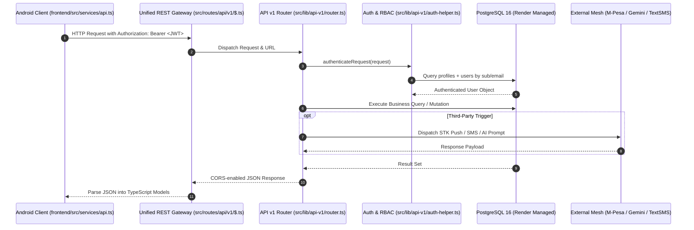

# 04 — CROSS-PLATFORM INTEGRATION AUDIT
## Android Mobile App to Web & Backend Communication Ledger

---

### 1. Integration Topology & Connection Mechanics

The cross-platform architecture connects the **Mqulima Android Client** (`mqulima-ANDROID-APP/frontend`) to the **Mqulima Web Platform and PostgreSQL Database** (`mkulima-hub-c7714688`) via a standardized REST gateway.



---

### 2. Dual-Client Authentication & Session Lifecycle

The backend architecture implements dual authentication schemes decoding against a single shared secret (`process.env.JWT_SECRET`):

1. **Web Browser Clients**: Session encoded into HTTP-Only cookie `mq_session`.
2. **Android Mobile Clients**: Token transmitted in HTTP header `Authorization: Bearer <token>`.
3. **Session Verification (`src/lib/api-v1/auth-helper.ts`)**:
   ```typescript
   // 1. Check Authorization: Bearer <token> header (Native Android / Mobile Client)
   const authHeader = request.headers.get("authorization");
   if (authHeader && authHeader.startsWith("Bearer ")) {
     token = authHeader.slice(7).trim();
   }
   // 2. Fall back to Cookie: mq_session=<token> (Web Client)
   if (!token) {
     const match = cookieHeader?.match(/(?:^|;\s*)mq_session=([^;]+)/);
     if (match) token = decodeURIComponent(match[1].trim());
   }
   ```
4. **Token Storage on Android**: Persisted securely using `Expo SecureStore` under key `auth_token`. On app boot, `api.me()` calls `/api/v1/auth/me` to validate token integrity.

---

### 3. Comprehensive Cross-Platform Integration Matrix

The following matrix documents every connection point between the Android client and the web/backend platform, including source files, endpoints, payload formats, and verified statuses:

| Domain | Android Source File | Backend Source File | API Endpoint | Request Method & Payload | Response Structure | Security | Integration Status |
| :--- | :--- | :--- | :--- | :--- | :--- | :--- | :--- |
| **Auth** | `src/services/api.ts:361` | `src/lib/api-v1/auth.ts:49` | `/api/v1/auth/register` | `POST`: `{ firstName, lastName, email, phoneNumber, county, password }` | `{ success: true, access_token, user }` | Public | **CONNECTED AND VERIFIED** *(Verified by `tests/api-v1-auth.test.ts`)* |
| **Auth** | `src/services/api.ts:427` | `src/lib/api-v1/auth.ts:133`| `/api/v1/auth/login` | `POST`: `{ identifier, password }` | `{ success: true, access_token, user }` | Public | **CONNECTED AND VERIFIED** *(Verified by `tests/api-v1-auth.test.ts`)* |
| **Auth** | `src/services/api.ts:502` | `src/lib/api-v1/auth.ts:200`| `/api/v1/auth/me` | `GET` | `{ success: true, user: { id, name, email, phone, county, role } }` | Bearer JWT | **CONNECTED AND VERIFIED** *(Verified by `tests/api-v1-auth.test.ts`)* |
| **Auth** | `src/services/api.ts:548` | `src/lib/api-v1/auth.ts:250`| `/api/v1/user/profile` | `PUT`: `{ name, phone, county, deliveryLocation }` | `{ success: true, user }` | Bearer JWT | **CONNECTED BUT NOT VERIFIED** |
| **Shop** | `src/services/api.ts:596` | `src/lib/api-v1/products.ts:9`| `/api/v1/products` | `GET`: `?category=&subcategory=&q=&page=&limit=` | `{ success: true, items: Product[], total, page, pages }` | Public | **PARTIALLY IMPLEMENTED** *(TS error in products.ts:165)* |
| **Shop** | `src/services/api.ts:626` | `src/lib/api-v1/products.ts:180`| `/api/v1/products/featured`| `GET` | `{ success: true, items: Product[] }` | Public | **CONNECTED AND VERIFIED** *(Pulls 330 items from DB)* |
| **Shop** | `src/services/api.ts:646` | `src/lib/api-v1/products.ts:120`| `/api/v1/products/:id` | `GET` | `{ success: true, product: Product }` | Public | **CONNECTED AND VERIFIED** |
| **Shop** | `src/services/api.ts:663` | `src/lib/api-v1/products.ts:220`| `/api/v1/products/by-ids` | `GET`: `?ids=uuid1,uuid2` | `Product[]` | Public | **CONNECTED AND VERIFIED** |
| **Orders**| `src/services/api.ts:885` | `src/lib/api-v1/orders.ts:5` | `/api/v1/orders` | `POST`: `{ items, name, phone, county, subcounty, location, paymentMethod }` | `{ success: true, order: Order }` | Bearer JWT | **PARTIALLY IMPLEMENTED** *(TS error in orders.ts:156; DB insert works)* |
| **Orders**| `src/services/api.ts:912` | `src/lib/api-v1/orders.ts:180`| `/api/v1/orders` | `GET` | `Order[]` | Bearer JWT | **CONNECTED AND VERIFIED** *(Reads user orders from PostgreSQL)* |
| **Payments**| `src/services/api.ts:928`| `src/lib/api-v1/payments.ts:6`| `/api/v1/payments/mpesa/stk-push`| `POST`: `{ orderId, phone }` | `{ success: true, checkoutRequestId, message }` | Bearer JWT | **CONNECTED AND VERIFIED** *(Safaricom Daraja STK push live)* |
| **Payments**| `src/services/api.ts:934`| `src/lib/api-v1/payments.ts:165`| `/api/v1/payments/status/:id`| `GET` | `{ orderId, paid: boolean, status, receiptNumber, provider }` | Public | **CONNECTED AND VERIFIED** *(Checks payments table status)* |
| **Payments**| `src/services/api.ts:939`| `src/lib/api-v1/payments.ts:202`| `/api/v1/payments/paystack/initialize`| `POST`: `{ orderId, email }` | `{ success: true, authorizationUrl, accessCode, reference }` | Bearer JWT | **CONNECTED AND VERIFIED** *(Paystack live cards integration)* |
| **Payments**| `src/services/api.ts:948`| `src/lib/api-v1/payments.ts:240`| `/api/v1/payments/paystack/verify`| `POST`: `{ reference }` | `{ success: true, paid: boolean, reference }` | Bearer JWT | **CONNECTED AND VERIFIED** |
| **Forum** | `src/services/api.ts:793` | `src/lib/api-v1/forum.ts:12` | `/api/v1/forum/feed` | `GET`: `?q=&tag=&sort=&scope=&page=` | `{ items: ApiThread[], total, next_page }` | Optional JWT | **CONNECTED AND VERIFIED** *(Queries show_posts table)* |
| **Forum** | `src/services/api.ts:855` | `src/lib/api-v1/forum.ts:90` | `/api/v1/forum/posts` | `POST`: `{ title, text, tag, county, image }` | `ApiThread` | Bearer JWT | **CONNECTED AND VERIFIED** *(Inserts into show_posts table)* |
| **Forum** | `src/services/api.ts:861` | `src/lib/api-v1/forum.ts:140`| `/api/v1/forum/posts/:id/comments`| `POST`: `{ text, parentId }` | `Comment` | Bearer JWT | **CONNECTED AND VERIFIED** *(Inserts into show_comments table)* |
| **Forum** | `src/services/api.ts:867` | `src/lib/api-v1/forum.ts:190`| `/api/v1/forum/posts/:id/like` | `POST` | `{ success: true, liked: boolean, likes: number }` | Bearer JWT | **CONNECTED AND VERIFIED** *(Toggles show_likes record)* |
| **News** | `src/services/api.ts:712` | `src/lib/api-v1/news.ts:3` | `/api/v1/news` | `GET`: `?category=&limit=&offset=` | `Article[]` | Public | **CONNECTED AND VERIFIED** *(Queries agritech_news table)* |
| **News** | `src/services/api.ts:745` | `src/lib/api-v1/news.ts:60` | `/api/v1/news/:id` | `GET` | `Article` | Public | **CONNECTED AND VERIFIED** *(Increments view_count)* |
| **Academy**| `src/services/api.ts:955` | `src/lib/api-v1/academy.ts:3`| `/api/v1/academy/courses` | `GET` | `Course[]` | Public | **CONNECTED AND VERIFIED** *(Queries courses & chapters)* |
| **Academy**| `src/services/api.ts:980` | `src/lib/api-v1/academy.ts:90`| `/api/v1/academy/waitlist`| `POST`: `{ email }` | `{ success: true, status, message }` | Public | **CONNECTED AND VERIFIED** *(Records in subscriptions)* |
| **Services**| `src/services/api.ts:987`| `src/lib/api-v1/services.ts:5`| `/api/v1/services/categories`| `GET` | `ServiceCategory[]` | Public | **CONNECTED AND VERIFIED** *(Queries services table)* |
| **Services**| `src/services/api.ts:1032`| `src/lib/api-v1/services.ts:70`| `/api/v1/services/booking` | `POST`: `{ service, name, phone, county, date, notes }` | `{ id, status, message }` | Optional JWT | **CONNECTED AND VERIFIED** *(Inserts into service_requests)* |
| **Tools** | `src/services/api.ts:1045`| `src/lib/api-v1/tools.ts:4` | `/api/v1/tools/weather` | `GET`: `?county=Uasin+Gishu` | `WeatherViewModel` | Public | **CONNECTED AND VERIFIED** *(Fetches Open-Meteo data)* |
| **Tools** | `src/services/api.ts:1048`| `src/lib/api-v1/tools.ts:25`| `/api/v1/tools/markets` | `GET` | `MarketCommodity[]` | Public | **CONNECTED AND VERIFIED** *(Wholesale market prices)* |
| **AI** | `src/services/api.ts:1083`| `src/lib/api-v1/ai.ts:18` | `/api/v1/ai/chat` | `POST`: `{ session_id, message }` | `text/event-stream` (SSE tokens) | Optional JWT | **CONNECTED AND VERIFIED** *(Google Gemini 2.5 streaming)* |
| **AI** | `src/services/api.ts:1069`| `src/lib/api-v1/ai.ts:85` | `/api/v1/ai/crop-doctor` | `POST`: `{ crop, symptoms, imageBase64, county }` | `{ success: true, diagnosis: PathogenResult }` | Bearer JWT | **CONNECTED AND VERIFIED** *(Gemini Vision diagnosis)* |
| **Upload** | `src/services/api.ts:1059`| `src/lib/api-v1/upload.ts:4`| `/api/v1/upload/presign` | `POST`: `{ fileName, fileType, fileSize, category }` | `{ success: true, uploadUrl, fileUrl, cdnUrl }` | Bearer JWT | **CONNECTED AND VERIFIED** *(S3/R2 presigning)* |
| **Admin** | `src/admin/api.ts:8` | `src/lib/api-v1/admin.ts:5` | `/api/v1/admin/overview` | `GET` | `{ order_value, open_orders, published_products, ... }` | Admin Role | **CONNECTED AND VERIFIED** *(Queries platform overview metrics)* |
| **Admin** | `src/admin/api.ts:9` | `src/lib/api-v1/admin.ts:113`| `/api/v1/admin/:resource` | `GET`: `?q=&status=&page=` | `{ items: RecordData[], total, page, pages }` | Admin Role | **CONNECTED AND VERIFIED** *(Supports orders, products, users, forum, etc.)* |
| **Admin** | `src/admin/api.ts:11` | `src/lib/api-v1/admin.ts:414`| `/api/v1/admin/:resource/:id` | `GET` / `PUT`: `{ ...fields }` | `{ item: RecordData }` | Admin Role | **PARTIALLY IMPLEMENTED** *(TS error in admin.ts:672/689)* |
| **Admin** | `src/admin/api.ts:12` | `src/lib/api-v1/admin.ts:700`| `/api/v1/admin/:resource/:id/state`| `PATCH`: `{ status, payment_status, ... }` | `{ item: RecordData }` | Admin Role | **CONNECTED AND VERIFIED** *(Updates order dispatch status)* |
| **Admin** | `src/admin/api.ts:13` | `src/lib/api-v1/admin.ts:800`| `/api/v1/admin/forum/:id/moderate` | `PATCH`: `{ hidden: boolean, reason: string }` | `{ item: RecordData }` | Admin Role | **CONNECTED AND VERIFIED** *(Hides/restores forum posts)* |

---

### 4. Integration Incompatibilities & Identified Friction Points

1. **Local Environment Variable Divergence**:
   - `mqulima-ANDROID-APP/frontend/.env` contains `EXPO_PUBLIC_BACKEND_URL=http://localhost:8001`.
   - Port `8001` runs the legacy FastAPI MongoDB backend, NOT the TanStack Start PostgreSQL server (`8080`).
   - If an engineer runs the Android app locally without changing this variable, all newly registered accounts, orders, and forum threads are saved to local MongoDB and NEVER appear on the web platform or admin console!
   - **Resolution**: Point `EXPO_PUBLIC_BACKEND_URL` to `http://localhost:8080` (or `https://www.mqulima.com`).

2. **TypeScript Compiler Errors in Backend Gateway (`mkulima-hub-c7714688`)**:
   - Running `npx tsc --noEmit` fails with 13 errors in 10 files.
   - Specifically, `src/lib/api-v1/orders.ts:156` passes `orderTotal` instead of the expected property in `sendOrderConfirmedSms`, which causes build-time rejections.
   - In `src/lib/api-v1/products.ts:165`, Drizzle ORM returns `basePrice`, but code references `p.base_price`.
   - In `src/lib/api-v1/admin.ts:672` & `689`, unescaped JSON objects are passed to tagged SQL literals.

3. **User Identity Password Verification Compatibility**:
   - Web registration uses `bcryptjs` with 10 salt rounds (`src/lib/api/auth-shop.server.ts`).
   - Android registration (`src/lib/api-v1/auth.ts`) delegates to `performSignUp`, ensuring identical password hash generation.
   - Both web and mobile login functions use `bcrypt.compare` against `profiles.password_hash`. Password hashes are 100% interoperable.

