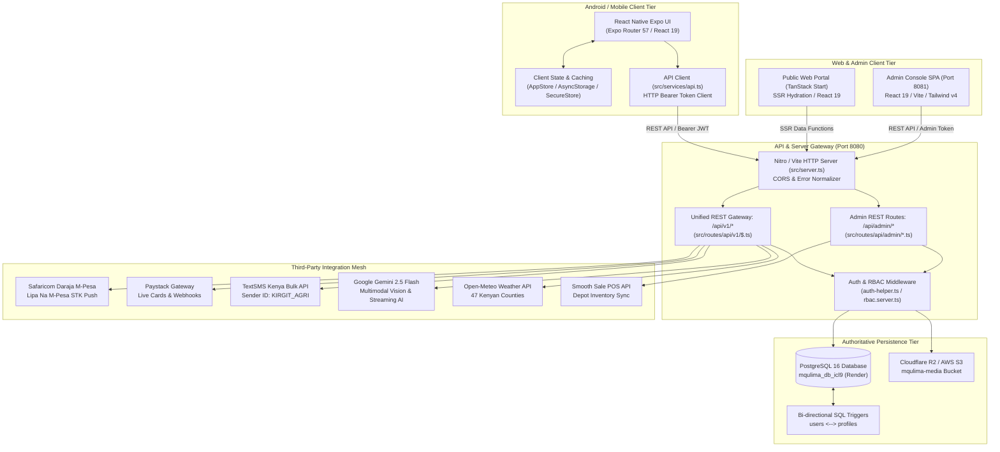
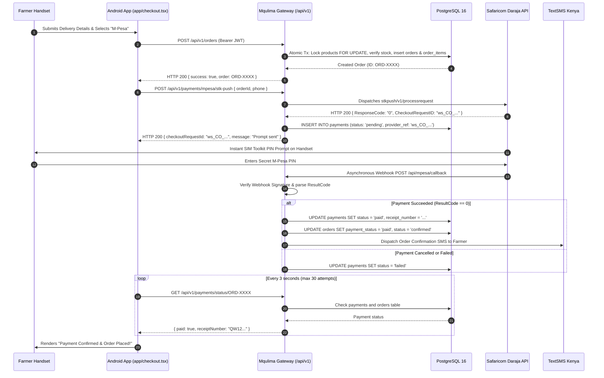
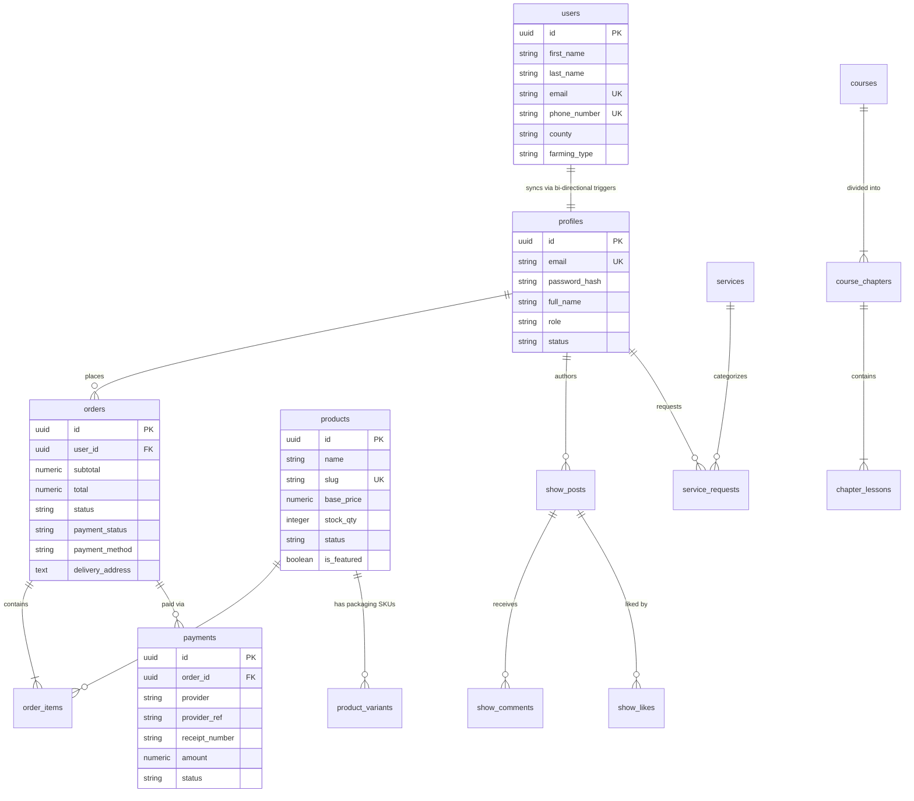
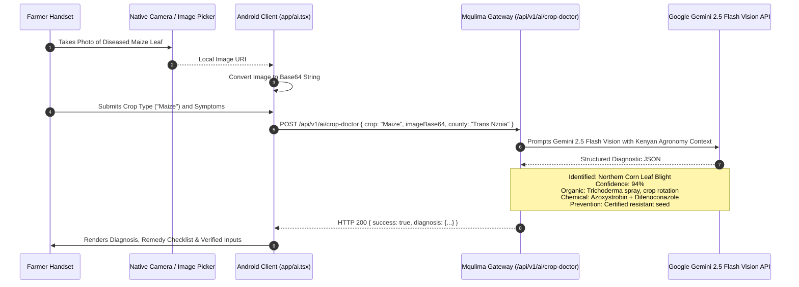

# 09 — SYSTEM ARCHITECTURE DIAGRAMS
## Visual Architecture, Workflows & Cross-Platform Topologies

---

### 1. Overall System Topology



---

### 2. Dual-Client Authentication Flow

```mermaid
sequenceDiagram
    autonumber
    participant Mobile as Android App (api.ts)
    participant Web as Web Client (auth.sign-in.tsx)
    participant Gateway as Server Gateway (server.ts)
    participant Auth as Auth Handler (auth.ts)
    participant DB as PostgreSQL (profiles / users)

    alt Mobile Client Authentication
        Mobile->>Gateway: POST /api/v1/auth/login { identifier, password }
        Gateway->>Auth: handleAuthLogin(request)
        Auth->>DB: Query profiles by email or normalized phone
        DB-->>Auth: Profile Record with bcrypt hash
        Auth->>Auth: bcrypt.compare(password, hash)
        Auth->>Auth: signUserToken(userId, email, role) via jose
        Auth-->>Mobile: HTTP 200 { access_token: JWT, user: UserData }
        Mobile->>Mobile: SecureStore.setItem("auth_token", JWT)
    else Web Client Authentication
        Web->>Gateway: POST /api/auth/login { identifier, password }
        Gateway->>Auth: handleWebLogin(request)
        Auth->>DB: Query profiles
        DB-->>Auth: Profile Record
        Auth->>Auth: Verify bcrypt hash & generate JWT
        Auth-->>Web: Set-Cookie: mq_session=JWT; HttpOnly; SameSite=Lax
    end
```

---

### 3. Order Placement & M-Pesa STK Push Payment Lifecycle



---

### 4. Database Entity-Relationship Architecture



---

### 5. Multimodal AI Crop Doctor Vision Diagnostic Flow



